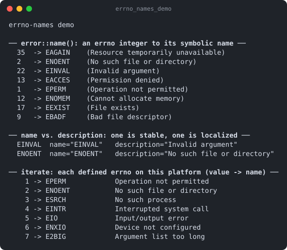

# errno-names

Part of [Kronuz C++ Libraries](https://github.com/Kronuz/cpp-libraries), a collection of small, reusable C++ libraries.

[](https://github.com/Kronuz/errno-names/actions/workflows/ci.yml)
[](LICENSE)


Turn an `errno` value into its symbolic name, `EINVAL`, and its description, on
Linux, macOS, and BSD, in C++17. So a log line reads
`EINVAL (Invalid argument)` instead of `22`.



## ✨ Highlights

- **The name you grep for.** `error::name(EINVAL)` is `"EINVAL"`, stable across
  locales and platforms.
- **The libc's description** through `strerror_r`.
- **Built for the platform.** Only the errnos the target defines are compiled in.
- **Never throws.** Unknown values read `"UNKNOWN"` and `"Unknown error"`.
- **O(1) lookups** from tables built once, on first use.

## 📦 Installation

Requires a C++17 compiler; CMake 3.14 or newer for the CMake route. CI builds it
on Linux (x86_64, arm64), macOS (arm64, x86_64), and FreeBSD, plus ASan, UBSan,
and TSan builds.

```cmake
include(FetchContent)
FetchContent_Declare(errno_names
  GIT_REPOSITORY https://github.com/Kronuz/errno-names.git
  GIT_TAG        main)
FetchContent_MakeAvailable(errno_names)

target_link_libraries(my_app PRIVATE errno_names::errno_names)
```

Or copy `error.hh` and `errnos.h`, side by side, onto your include path.

## 🚀 Quick start

```cpp
#include "error.hh"

#include <cerrno>
#include <cstdio>

int main() {
	int e = ENOENT;   // say, from a failed open()
	std::printf("open failed: %s (%s)\n", error::name(e).c_str(), error::description(e).c_str());
	// open failed: ENOENT (No such file or directory)
}
```

[`examples/demo.cc`](examples/demo.cc) prints a table of common errnos.

## 🎯 When to use it

- ✅ Logging and reporting system-call failures.
- ❌ An error-handling framework: it maps integers to strings, nothing more.

## 📚 Documentation

- [docs/API.md](docs/API.md): `name`, `description`, and caveats such as aliased
  values (`EAGAIN == EWOULDBLOCK`).
- [ARCHITECTURE.md](ARCHITECTURE.md): how the tables are built.
- [AGENTS.md](AGENTS.md): repository map and traps.

## 🛠️ Building and testing

```sh
cmake -B build && cmake --build build && ctest --test-dir build
./build/errno_names_demo
```

## 🤝 Contributing

Issues and pull requests are welcome. Read [AGENTS.md](AGENTS.md) first. CI must
pass on every platform.

## 📄 License

MIT, Copyright (c) 2015-2019 Dubalu LLC. See [LICENSE](LICENSE). Extracted from
[Xapiand](https://github.com/Kronuz/Xapiand).
